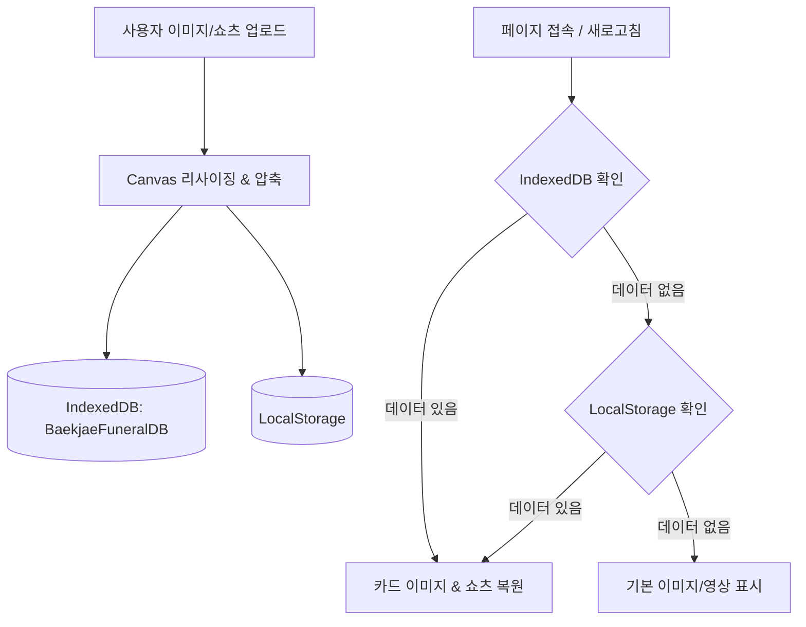

# Homepage Builder Skill (프리미엄 홈페이지 제작 가이드)

사용자 맞춤형 고품격 웹사이트(쇼핑몰, 기업 소개, 의전 서비스 등)를 기획부터 애니메이션, 데이터 영구 보존, Git 배포까지 일관된 품질로 구축하기 위한 체계적인 실행 가이드입니다.

---

## 1. 프로젝트 아키텍처 개요

```
homepage/
├── .agents/
│   └── skills/
│       └── homepage-builder/
│           └── SKILL.md            # 홈페이지 제작 표준 워크플로우 스킬
├── code_artifact.tsx               # React/Tailwind/Lucide 기반 모듈형 컴포넌트
├── index.html                      # 단독 실행 및 즉각 브라우저 프리뷰용 HTML5 번들
├── home_model.jpg                  # 공식 브랜드 모델 고해상도 대표 이미지
├── README.md                       # 프로젝트 소개 및 실행 가이드
└── .gitignore                      # Git 버전 관리 설정
```

---

## 2. 핵심 UI/UX 설계 및 구현 패턴

### [패턴 1] 홈 화면 세로 2분할 (Hero Split Layout)
- **목적**: 브랜드 메시지 전달과 미디어 몰입도를 극대화.
- **좌측 (브랜드 슬로건 & 메인 비주얼)**:
  - 감성적인 카피라이트, 신뢰감을 주는 타이포그래피.
  - 사용자 제공 맞춤 인물/제품 사진(`home_model.jpg`)을 배치하고 부드러운 라운딩(`rounded-3xl`)과 은은한 골드/다크 톤 프레임 적용.
- **우측 (9:16 세로형 쇼츠 플레이어)**:
  - 최신 숏폼 트렌드를 반영한 9:16 황금비율 컨테이너 (`aspect-[9/16]`).
  - **듀얼 소스 지원**:
    1. 로컬 비디오 파일 드래그 & 드롭 / 파일 선택 업로드.
    2. YouTube Shorts 링크(예: `https://youtube.com/shorts/...`) 입력 시 자동 iframe 임베드 변환.
  - 플레이어 주변 앰비언트 글로우 및 스마트 컨트롤 바 구성.

### [패턴 2] 마우스 오버 3D 팝업 물리 애니메이션 (Pop-forward Cards)
- **목적**: 핵심 가치 제안(품질, 배송, 상담 등)에 사용자의 시선을 집중시키고 물리적 실체감 제공.
- **CSS 물리 탄성 곡선**:
  ```css
  .feature-card-pop {
    position: relative;
    transition: transform 0.45s cubic-bezier(0.34, 1.56, 0.64, 1),
                box-shadow 0.45s cubic-bezier(0.34, 1.56, 0.64, 1),
                border-color 0.4s ease;
    will-change: transform, box-shadow;
  }
  .feature-card-pop:hover {
    transform: translateY(-16px) scale(1.045);
    box-shadow: 0 25px 40px -10px rgba(15, 23, 42, 0.22),
                0 12px 20px -8px rgba(180, 83, 9, 0.18);
    border-color: rgba(217, 119, 6, 0.55);
    z-index: 20;
  }
  .feature-card-pop:active {
    transform: translateY(-8px) scale(1.02);
  }
  ```
- **마이크로 인터랙션**:
  - 카드 상단에 은은한 금빛 그라데이션 하이라이트 바 점등.
  - 카드 내부 아이콘이 살짝 회전하며 확대(`scale(1.1) rotate(3deg)`).

### [패턴 3] 상품 카드 이미지 드래그 앤 드롭 & 4/3 세로 비율 피팅
- **이미지 비율 규격**: 카드 전체 높이의 약 75%를 차지하는 세로 4/3 비율(`aspect-[3/4]`, `object-cover object-top`).
- **드래그 앤 드롭 인터페이스**:
  - 카드마다 직관적인 점선 드래그 존 및 호버 시 안내 오버레이(`📸 이미지를 끌어다 놓으세요`).
- **클라이언트 리사이징 최적화 (Canvas API)**:
  - 대용량 사진 업로드 시 브라우저 버벅임을 방지하기 위해 가로 최대 1200px 리사이즈 후 JPEG 0.88 품질로 자동 압축하여 Base64 변환.

---

## 3. 브라우저 영구 보존 (Dual Persistence Architecture)

사용자가 드래그하여 교체한 이미지나 업로드한 쇼츠 영상이 새로고침 또는 재접속 후에도 유지되도록 이중 저장소 설계:



- **IndexedDB**: 수십~수백 MB의 동영상 Blob 및 고해상도 이미지를 제한 없이 안전하게 영구 저장.
- **LocalStorage**: 메타데이터, 텍스트 링크, 세션 설정의 즉각적인 폴백 캐시.

---

## 4. 다중 페이지 내비게이션 (SPA Seamless Tabs)

단일 페이지에서 지연 없는 전환과 완전한 사용자 경험을 제공:
1. **홈 (Home)**: 2분할 비주얼 히어로, 쇼츠 플레이어, 3D 팝업 핵심 가치 카드.
2. **상품소개 (Products)**: 카테고리 필터(전체, 수의, 상복, 의전용품), 드래그 앤 드롭 이미지 커스텀, 가격/혜택 안내.
3. **문의하기 (Inquiry)**: 24시간 긴급 출동 신청 및 1:1 상담 폼.
4. **자주 묻는 질문 (FAQ)**: 아코디언 인터랙션 기반의 사전 안내.

---

## 5. Git & GitHub 배포 파이프라인 워크플로우

### Step 1. Git 저장소 초기화 및 기본 브랜치
```bash
git init -b main
```

### Step 2. 표준 .gitignore 및 README.md 생성
- 불필요한 OS 캐시(`Thumbs.db`, `.DS_Store`)와 임시 파일 제외.
- 프로젝트 기능 및 구동 방법이 정리된 `README.md` 작성.

### Step 3. 스테이징 및 커밋
```bash
git add -A
git commit -m "feat: initial commit for Baekjae funeral homepage"
```

### Step 4. 원격 저장소 연결 및 푸시
```bash
git remote add origin https://github.com/<username>/<repo-name>.git
git push -u origin main
```
> **Tip**: GitHub Desktop이 설치되어 있다면 `File -> Add Local Repository` 후 원클릭 `Push origin`을 통해 웹 인증을 손쉽게 완료할 수 있습니다.

---

## 6. 품질 검증 체크리스트

- [x] **모바일/태블릿/데스크톱 반응형**: Flex/Grid 기반 유연한 레이아웃 확인
- [x] **3D 팝업 애니메이션 성능**: GPU 가속(`transform`, `will-change`) 적용 여부 확인
- [x] **드래그 앤 드롭 안정성**: 잘못된 파일 형식 차단 및 자동 용량 최적화 확인
- [x] **새로고침 지속성**: 브라우저를 닫고 다시 열었을 때 변경된 이미지와 영상이 그대로 유지되는지 검증
- [x] **독립 실행 무결성**: CDN 의존성을 최소화하고 로컬 파일만으로도 브라우저에서 즉시 구동 가능
